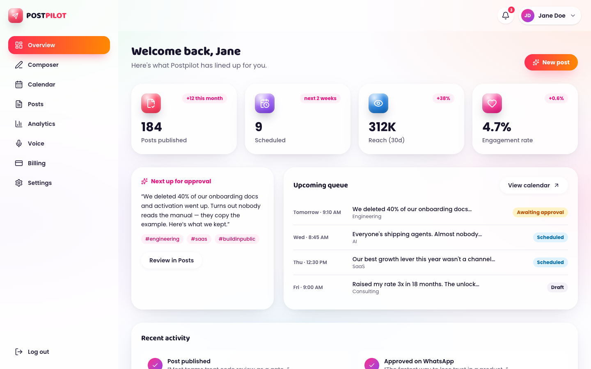
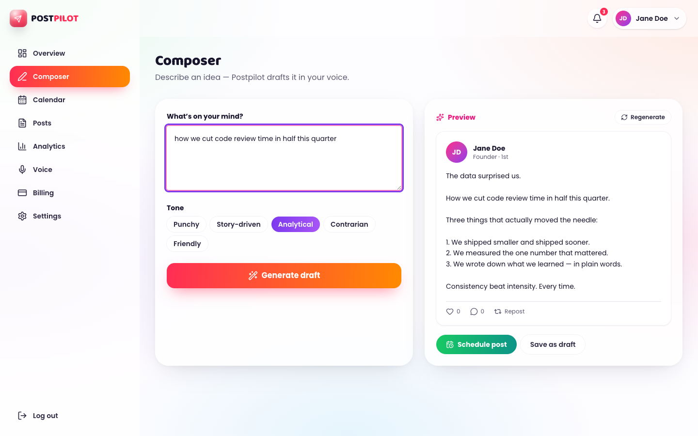
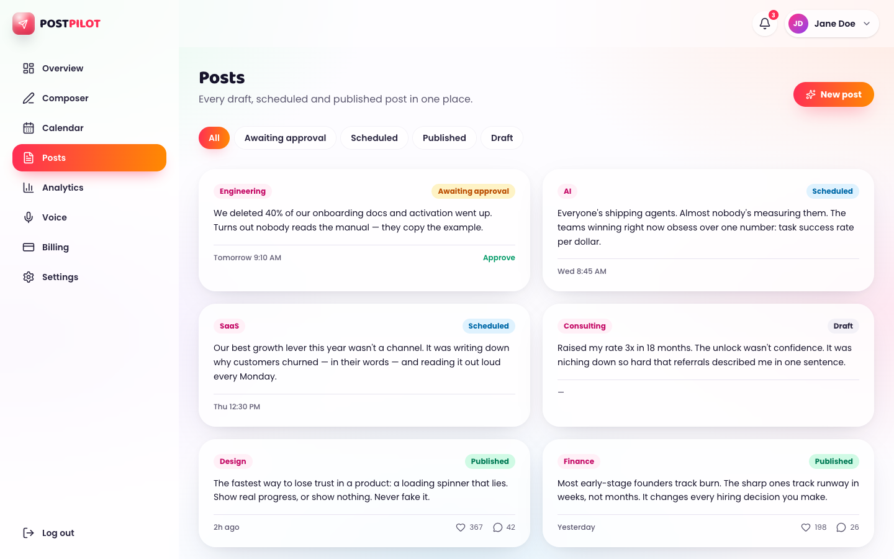
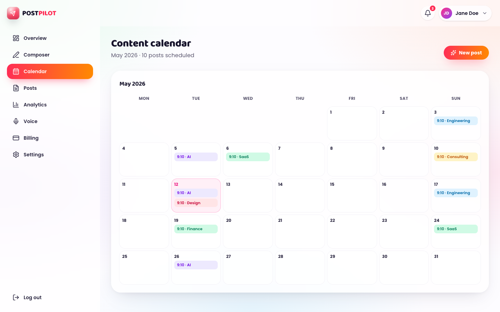
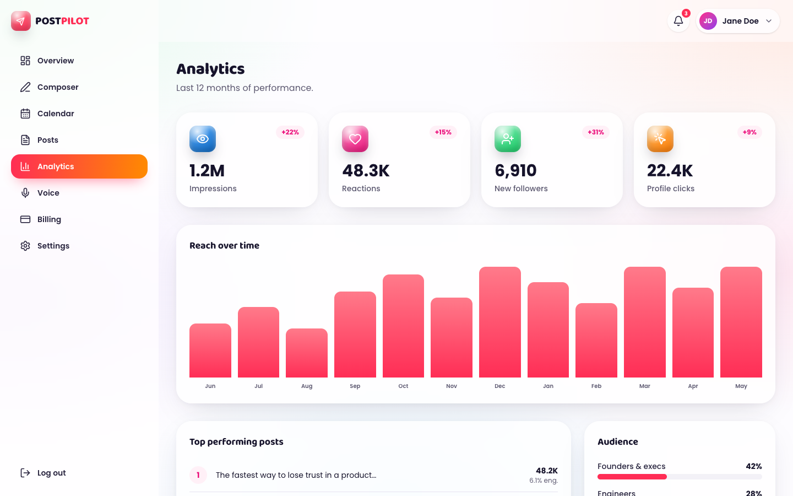
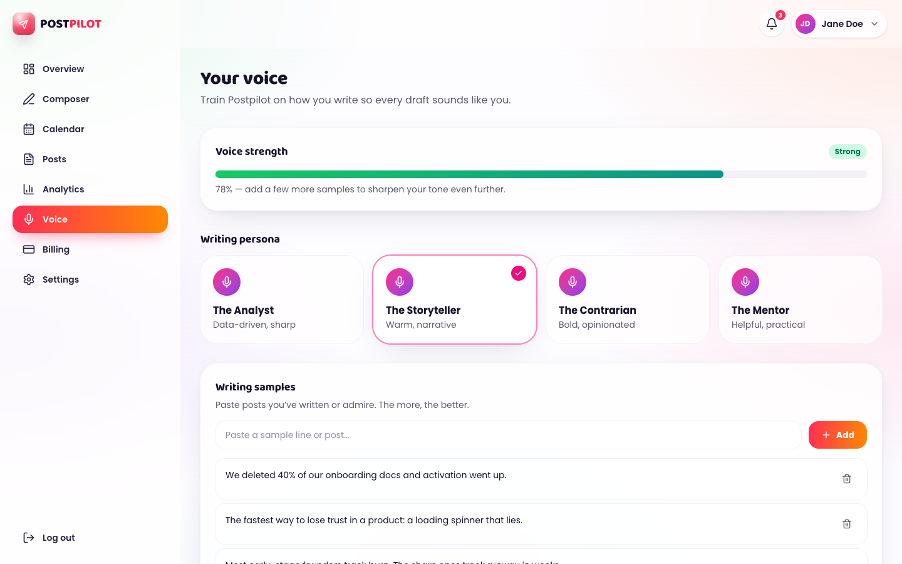
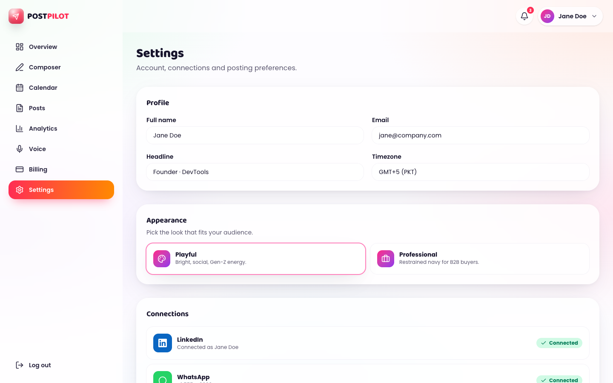
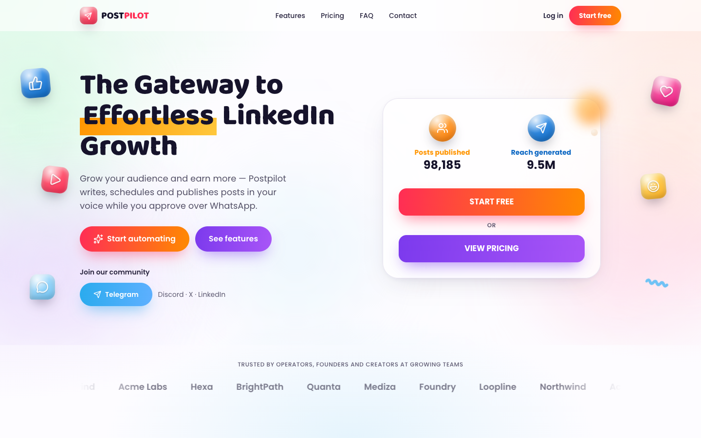
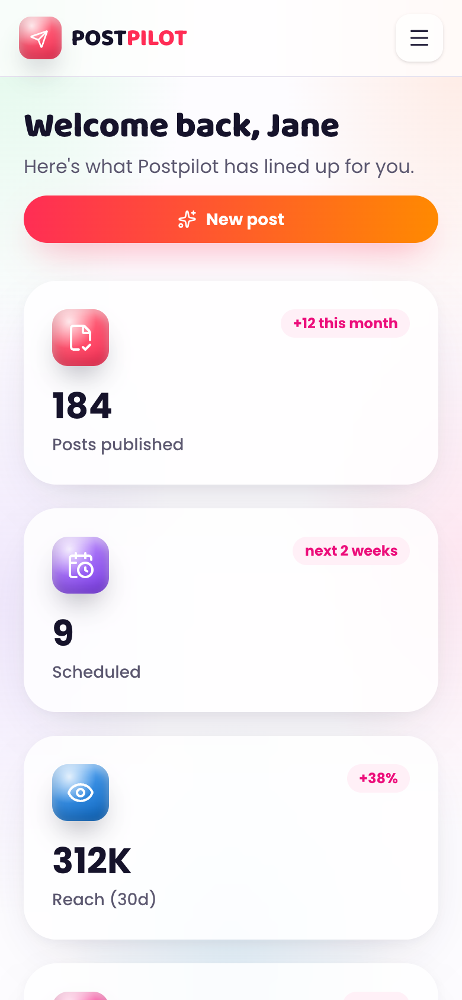
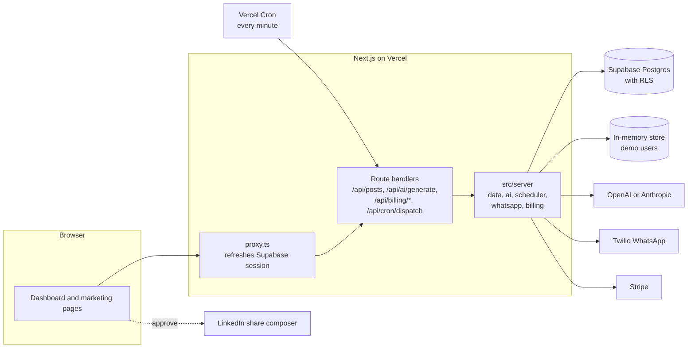

# Postpilot

**LinkedIn posts drafted in your voice, scheduled for you, and published only after you say yes.**

Postpilot is a Next.js app for founders and operators who know they should post on LinkedIn regularly but never find the hour to write. You give it an idea and a tone, it drafts the post, and the post goes into a queue. When a post is due, a scheduled job asks you to approve it over WhatsApp. Approving opens LinkedIn's own composer with the text already filled in, so you publish with one tap and nothing goes out without you.




**Demo video (65 s):** [docs/demo/postpilot-demo.mp4](docs/demo/postpilot-demo.mp4). It was recorded from the app running locally with the demo account. There is no public deployment.

## Why it exists

Consistency matters more than brilliance on LinkedIn, and consistency is exactly what busy people lose first. The usual tools solve this by auto-posting on your behalf, which has two problems: posts stop sounding like you, and unattended posting through unofficial channels breaks LinkedIn's terms and can get accounts restricted.

Postpilot keeps a human in the loop on purpose. Writing is automated, publishing is not. Every post needs an explicit approval, and the final publish happens in LinkedIn's own composer. The reasoning behind that decision is written up in [docs/LINKEDIN_COMPLIANCE.md](docs/LINKEDIN_COMPLIANCE.md).

## What it does

| Area | What works today |
|---|---|
| **Composer** | Turns an idea and one of five tones into a draft through OpenAI (`gpt-4o-mini`) or Anthropic (`claude-haiku-4-5`). With no API key it uses a deterministic local template, so the flow works offline. Drafts can be saved or scheduled. |
| **Posts** | Lists every post with status filters (awaiting approval, scheduled, published, draft). Approving a post marks it published and opens LinkedIn's share composer with the text prefilled. |
| **Scheduler** | A Vercel Cron job (`/api/cron/dispatch`) finds posts whose time has come, sends a WhatsApp approval request through Twilio, and moves them to "Awaiting approval". The endpoint is protected by `CRON_SECRET` and refuses to run open once a service-role key is configured. |
| **Accounts** | Sign-in with LinkedIn through Supabase Auth (OIDC). Without Supabase, a signed demo cookie opens the full dashboard. |
| **Billing backend** | A Stripe Checkout endpoint and a signature-verified webhook that keeps a `subscriptions` table in sync. The billing screen does not call checkout yet (see limitations). |
| **Marketing site** | Landing, features, pricing, FAQ, about, contact and legal pages, with metadata, `robots.txt` and a sitemap. |
| **Themes** | A "Playful" and a "Professional" look, switchable from settings and remembered per browser. |

## Product tour

The demo video walks through the main loop: landing page, demo sign-in, drafting a post, scheduling it, filtering the queue and approving a post. The screenshots below come from the same local build.

| Composer | Posts queue |
|---|---|
|  |  |
| **Calendar** | **Analytics** |
|  |  |
| **Voice** | **Settings** |
|  |  |

<p>
  
  
</p>

The calendar, analytics, voice and settings screens show sample content. They are designed but not yet backed by data.

## How it works



A few decisions shape the codebase:

- **Every integration is optional.** Each external service lives behind one module in `src/server/`, and each module checks whether its environment variables are present (`aiConfigured()`, `adminConfigured()` and friends in `src/lib/env.ts`). If they are not, it falls back to local behaviour instead of failing. The whole product can be clicked through on a laptop with no accounts anywhere.
- **Two storage paths, one interface.** Signed-in LinkedIn users read and write Postgres through the user's own Supabase session, so row-level security does the authorization. Demo users read and write an in-memory store. `src/server/data.ts` picks the path per request, and the UI does not know which one it is talking to.
- **No SDKs for third parties.** OpenAI, Anthropic, Twilio and Stripe are called with `fetch` against their REST APIs. That keeps the dependency list to Next, React, Supabase and an icon set, and makes the request each module sends easy to read.
- **Untrusted input is parsed at the edge.** Route handlers validate request bodies with small hand-written parsers (`parseCreatePostInput`, `parseGenerateInput`) that return typed results or a 400 with a message.
- **Next 16 conventions.** Session refresh runs in `proxy.ts` (the Next 16 replacement for `middleware.ts`) on the Node runtime, which `@supabase/ssr` needs.

### Data model

Defined in [`supabase/schema.sql`](supabase/schema.sql). Every table has row-level security policies that limit reads and writes to the owning user, and a trigger creates a profile row on sign-up.

| Table | Purpose |
|---|---|
| `profiles` | Name, headline, timezone, voice persona, WhatsApp number and publish mode (`manual` or `auto`) |
| `posts` | Body, tag, status (`Draft`, `Awaiting approval`, `Scheduled`, `Published`, `Failed`), schedule and publish times, engagement counts |
| `voice_samples` | Writing samples intended for voice matching |
| `notifications` | In-app notifications |
| `subscriptions` | Plan and status mirrored from Stripe webhooks |

### API

All routes except the cron and webhook endpoints need a signed-in user (LinkedIn or demo) and return `401` otherwise.

| Method and path | What it does |
|---|---|
| `GET /api/posts` | List the caller's posts |
| `POST /api/posts` | Create a draft, or a scheduled post when `scheduledFor` is set. Body: `{ body, tag?, scheduledFor? }` |
| `POST /api/posts/:id/approve` | Mark a post published and return `{ shareUrl }` for LinkedIn's composer |
| `POST /api/ai/generate` | Draft a post. Body: `{ idea, tone?, samples? }`. Returns `{ text, source }` where `source` is `openai`, `anthropic` or `fallback` |
| `POST /api/billing/checkout` | Create a Stripe Checkout session |
| `POST /api/billing/webhook` | Stripe webhook, verified with `STRIPE_WEBHOOK_SECRET` |
| `GET /api/cron/dispatch` | Scheduler tick, requires `Authorization: Bearer $CRON_SECRET` |
| `GET /api/auth/demo`, `GET /api/auth/logout`, `GET /auth/callback` | Demo sign-in, sign-out and the Supabase OAuth callback |

[docs/BACKEND.md](docs/BACKEND.md) has the wiring table for each integration and a go-live checklist.

## Tech stack

- **Frontend:** Next.js 16 (App Router, Turbopack), React 19, TypeScript in strict mode, Tailwind CSS 4, lucide-react icons
- **Backend:** Next.js route handlers on the Node runtime, Vercel Cron
- **Data and auth:** Supabase Postgres with row-level security, Supabase Auth with the LinkedIn (OIDC) provider, `@supabase/ssr` for cookie sessions
- **Integrations:** OpenAI and Anthropic (drafting), Twilio WhatsApp (approvals), Stripe (billing), all over REST
- **Quality:** Vitest, Testing Library and jsdom, ESLint 9 with the Next.js config, GitHub Actions

## Getting started

You need Node 22 and npm.

```bash
npm install
cp .env.example .env.local
npm run dev
```

Every variable in `.env.example` is optional for local use. Open http://localhost:6401, choose **Log in**, then **Or continue with a demo account**. You land on the dashboard with seeded posts, and drafting uses the local template.

To run against real services, fill in the relevant block in `.env.local`:

| Area | Variables |
|---|---|
| App | `APP_URL`, `SESSION_SECRET` |
| Supabase | `NEXT_PUBLIC_SUPABASE_URL`, `NEXT_PUBLIC_SUPABASE_ANON_KEY`, `SUPABASE_SERVICE_ROLE_KEY` |
| AI | `OPENAI_API_KEY` or `ANTHROPIC_API_KEY` |
| WhatsApp | `TWILIO_ACCOUNT_SID`, `TWILIO_AUTH_TOKEN`, `TWILIO_WHATSAPP_FROM` |
| Scheduler | `CRON_SECRET` |
| Billing | `STRIPE_SECRET_KEY`, `STRIPE_PRICE_PRO`, `STRIPE_WEBHOOK_SECRET` |

For a real database, run `supabase/schema.sql` in the Supabase SQL editor, enable the LinkedIn (OIDC) provider, and add `http://localhost:6401/auth/callback` to its redirect URLs.

| Command | What it does |
|---|---|
| `npm run dev` | Dev server on port 6401 |
| `npm run build` then `npm start` | Production build and server |
| `npm run lint` | ESLint |
| `npm run typecheck` | `tsc --noEmit` |
| `npm test` | Vitest, once (`npm run test:watch` to watch) |

## Project structure

```
src/
  app/(marketing)/   public pages sharing a header and footer
  app/dashboard/     signed-in app; the layout redirects to /login without a session
  app/api/           route handlers: posts, ai, auth, billing, cron
  components/        marketing sections, the dashboard UI kit, shared layout
  lib/               env access, session cookie, current-user lookup, Supabase clients
  server/            data access and integrations (server-only)
  proxy.ts           Supabase session refresh
supabase/schema.sql  tables, RLS policies, sign-up trigger
docs/                backend wiring, LinkedIn compliance notes, screenshots, demo video
```

## Testing

There are 12 component tests across 4 files, run in jsdom with Testing Library. They stub `fetch` at the network boundary rather than mocking modules, so they exercise the real components and their error handling:

- **Posts page:** loading, status filters, the empty state, error and retry, and approve opening LinkedIn
- **Composer:** idea validation, the tone sent to the API, API error messages, scheduling and navigating to the queue
- **Theme toggle:** persisting the choice, restoring it, and ignoring unknown stored values
- **Contact form:** saying plainly that nothing was sent

GitHub Actions runs lint, typecheck, tests and a production build on pushes to `main` and on pull requests. Lint, typecheck, all 12 tests and `npm run build` pass locally on Node 22.

The server modules (data access, AI, scheduler, billing) have no unit tests yet.

## Deployment

The project is set up for Vercel: `vercel.json` registers the cron job, and CI checks that the production build succeeds. It is not deployed anywhere public. [docs/BACKEND.md](docs/BACKEND.md) lists what needs configuring before a real launch.

## Status and limitations

This is an MVP. The core loop (draft, schedule, approve, publish by hand) works end to end in the demo, and the backend for real accounts is written, but some pieces are deliberately unfinished:

- **No auto-publishing.** Posting directly to LinkedIn needs partner API access. The `auto` publish mode exists in the schema and code path but does nothing yet.
- **WhatsApp replies are one-way.** The approval message links to the posts page, but the page does not yet act on its `?approve=` parameter, and there is no handler for a "YES" reply.
- **Voice matching is not connected.** The generation API accepts writing samples, but the composer does not send them, and the Voice screen is not saved anywhere.
- **Billing UI is not wired.** The checkout and webhook endpoints exist, but the billing screen shows sample data and has no upgrade button.
- **Sample screens.** Calendar, analytics, voice and settings show static content.
- **Contact form is demo-only.** It validates input and tells the visitor that nothing was sent.
- **Logout uses a GET link.** It should be a POST.
- **The demo store is per server process.** It is shared by everyone using the same server and resets on restart.

## Roadmap

Planned, not built:

1. Act on WhatsApp approvals directly: handle the `?approve=` link and "YES" replies.
2. Send stored voice samples with each generation request.
3. Back the calendar and analytics screens with real post data.
4. Wire the billing screen to Stripe Checkout and the customer portal.
5. Unit tests for the server modules, starting with the scheduler.

## License

No license has been chosen yet, so all rights are reserved by the author.
